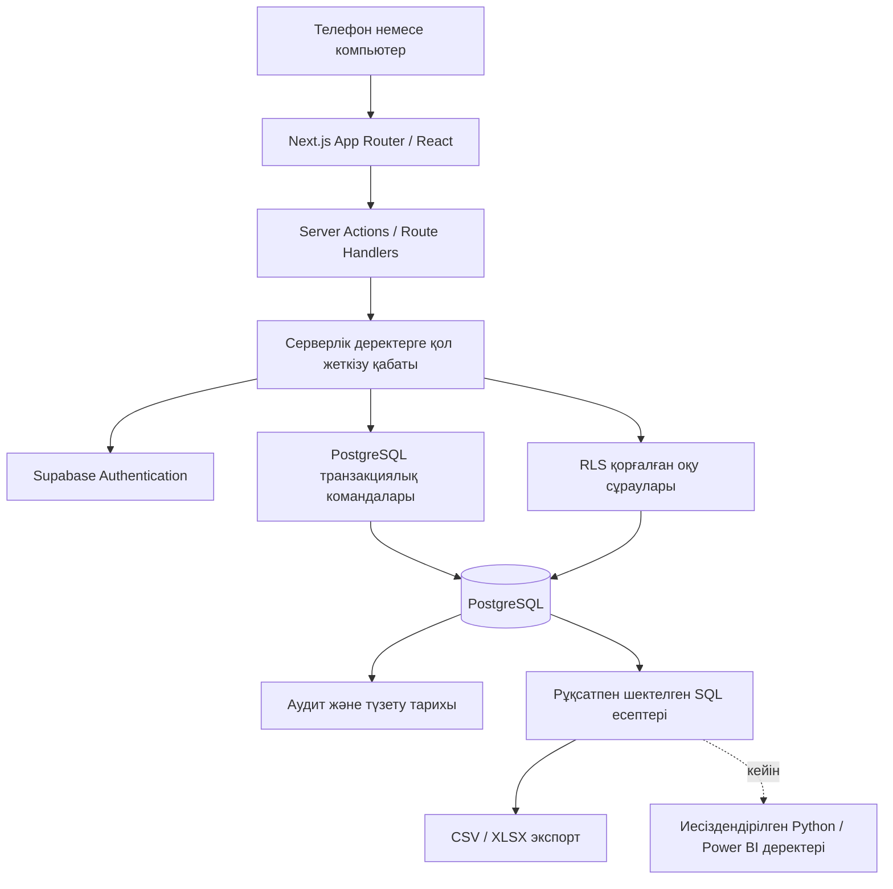

# Жүйе архитектурасы

## 1. Архитектуралық тәсіл

**Модульдік монолит** ұсынамын: интерфейс пен серверлік логика бір Next.js жобасында, деректер PostgreSQL ішінде болады. Бір салон үшін бөлек микросервистер операциялық күрделілікті арттырады. Модульдердің шекарасы анық болса, қажет болғанда экспортты немесе аналитиканы кейін бөлек қызметке шығаруға болады.



Vercel — сұралған стек бойынша Next.js орналастыруының бастапқы нұсқасы. Supabase Cloud немесе Қазақстанда орналастырылатын Supabase нұсқасы жөніндегі шешім дербес деректер талаптары тексерілгеннен кейін қабылданады. Бұл диаграмма логикалық құрылымды көрсетеді, hosting келісімін білдірмейді.

## 2. Технологиялардың міндеті

| Технология | Жобадағы міндеті және таңдау себебі |
| --- | --- |
| Next.js App Router | Маршруттар, серверде дерек оқу, формаларды өңдеу, экспорт endpoint-тері |
| React + TypeScript | Қайта пайдаланылатын интерфейс, тексерілетін типтер; TypeScript runtime валидацияны алмастырмайды |
| Tailwind CSS + shadcn/ui | Телефонға бейімделетін бірізді компоненттер; қолжетімділік нақты құрылғыларда тексеріледі |
| Supabase Auth | Құпиясөздер, шақыру, сессия, қалпына келтіру; қолданба password кестесін жасамайды |
| PostgreSQL | Байланыстар, шектеулер, нақты ақша арифметикасы, транзакциялар, SQL есептері |
| RLS | Дерекқордағы жол деңгейіндегі рұқсат; интерфейс шектеулерінен тәуелсіз қорғаныс |
| Git + GitHub | Өзгерістер тарихы, review, CI, миграцияларды нұсқалау |
| Vercel | Заңдық және деректер ағыны тексерілген жағдайда web deployment |

Нақты нұсқалар іске асырудың бірінші кезеңінде өзара үйлесімді stable нұсқалардан таңдалып, lockfile арқылы бекітіледі. Қазір пакет нұсқалары бекітілмейді және ештеңе орнатылмайды.

## 3. Қабаттар мен модульдер

- `auth`: сессия, белсенді мүшелік, рөл, шақыру.
- `employees`, `services`: анықтамалықтар және табыс есептеу ережелері.
- `customers`, `visits`: клиентпен байланыс, көрсетілген қызмет және орындаушы.
- `payments`, `expenses`, `reconciliation`: ақша қозғалысы және күнді салыстыру.
- `audit`, `corrections`: өзгеріс тарихы, түзету сұраулары.
- `analytics`, `exports`: рұқсатқа сай есептер.

UI компоненттері SQL бизнес ережесін қайталамайды. Server Action кірісті тексереді, сессия мен рөлді анықтайды және қолданбалық команданы шақырады. DAL тек қажетті өрістері бар DTO қайтарады. Әрбір операцияға авторизация қажет; тек layout немесе маршрут redirect-і жеткіліксіз. Бұл тәсіл [Next.js Data Security](https://nextjs.org/docs/app/guides/data-security) нұсқаулығына сәйкес келеді.

Қаржылық инварианттар мен көпкестелі жазу PostgreSQL функцияларында орындалады. Бірнеше жеке Supabase HTTP сұрауын бір транзакция деп есептеуге болмайды.

## 4. Негізгі жазу ағыны

1. Қызметкер клиентті таңдаусыз да жаңа келуді аша алады.
2. Қызмет, орындаушы, баға және қажет болса жеңілдік көрсетіледі. Баға мен табыс ережесін сервер анықтамалықтан алады.
3. Сервер пайдаланушыны, белсенді мүшелікті, жұмыс күнін және кіріс деректерін тексереді.
4. `record_visit` командасы бір транзакция ішінде келу, қызметтер, рұқсат болса төлемдер және аудитті жазады.
5. DB қайта есептеген сома және жазба нөмірі ғана «Сақталды» күйін береді.

Әкімші үшін қызмет пен төлемді бірге енгізуге болады; олар деректер моделінде бәрібір бөлек қалады. Қызметкер қызметті тіркегенде төлем автоматты түрде жасалмайды. Кейін `record_payment` командасы қолданылады.

Қайталанған түртуді `idempotency_key` тоқтатады. Бір кілтпен басқа мазмұн жіберілсе, конфликт қайтарылады. Желі үзіліп жауап жоғалса, сол кілтпен қайталау бастапқы нәтижені береді. Қарыз бен қайтарымды тексеру кезінде visit/payment жолдары құлыпталады. Күн жабылуы мен жаңа ақша операциясы ортақ business-day lock қолданады.

## 5. Интерфейс және тілдер

Бастапқы навигация: «Бүгін», «Қызмет қосу», «Менің табысым». Әкімшіге қосымша «Төлемдер» және «Күнді жабу», иесіне «Есептер» және «Баптаулар» беріледі.

`kk` және `ru` локальдары; маршруттарда `[locale]`, интерфейс мәтіндерінде тұрақты translation key қолданылады. DB enum мәндері аударылмайды. Қызмет атаулары `service_translations` арқылы аударылады. Жеке клиент аттары автоматты аударылмайды. Әдепкі интерфейс тілі қызметкерлермен келісіліп, пайдаланушы таңдауын сақтайды.

Қызметкер әдепкіде өзі орындаушы болады. Жиі қолданылатын қызметтер алда көрсетіледі; күн мен баға автоматты толтырылады. Телефон нөмірі, клиент аты немесе түсіндірме әр келуде міндеттелмейді. Қате өрістің қасында қазақша/орысша түсіндіріледі.

MVP онлайн жұмыс істейді. Желі жоқ кезде «Сақталды» хабарын көрсетпейді және құпия деректерді `localStorage` ішінде ұстамайды. Экрандағы енгізілген мәндер мүмкіндік болғанша жадта қалады. Тұрақты offline queue кейін жеке жоба ретінде қаралады.

## 6. Ұсынылатын болашақ файл құрылымы

Төмендегі құрылым — жоспар; бұл бумалар мен код файлдары қазір жасалған жоқ.

```text
dili-salon/
  README.md
  docs/
    architecture.md
    mvp-specification.md
    database-schema.md
    permissions-security.md
    roadmap-testing-deployment.md
    business-assumptions.md
    decisions/
  src/
    app/
      [locale]/
        (auth)/login/page.tsx
        (auth)/reset-password/page.tsx
        (workspace)/today/page.tsx
        (workspace)/visits/new/page.tsx
        (workspace)/visits/[visitId]/page.tsx
        (workspace)/employees/page.tsx
        (workspace)/services/page.tsx
        (workspace)/customers/page.tsx
        (workspace)/payments/page.tsx
        (workspace)/expenses/page.tsx
        (workspace)/reconciliation/page.tsx
        (workspace)/analytics/page.tsx
        (workspace)/settings/page.tsx
        layout.tsx
      auth/callback/route.ts
      api/exports/route.ts
      layout.tsx
      globals.css
    components/
      ui/
      layout/
    features/
      auth/
      employees/
      services/
      customers/
      visits/
      payments/
      expenses/
      reconciliation/
      corrections/
      audit/
      analytics/
      exports/
    server/
      auth/
      dal/
      commands/
    lib/
      supabase/client.ts
      supabase/server.ts
      money.ts
      dates.ts
      validation.ts
    i18n/
      routing.ts
      messages/kk.json
      messages/ru.json
    types/database.generated.ts
    proxy.ts
  supabase/
    migrations/
    tests/
    seed.sql
    config.toml
  tests/
    unit/
    integration/
    e2e/
  .github/workflows/ci.yml
  .env.example
  .gitignore
  package.json
```

Әр feature тек қажет болғанда `components/`, `schemas.ts`, `actions.ts` файлдарын алады. Барлық бос файлдарды алдын ала толтыру қажет емес. `proxy.ts` атауы таңдалған Next.js нұсқасымен тексеріледі. `seed.sql` тек жасанды деректерден тұрады. `.env.example` ішінде тек кілт атаулары мен бос үлгілер болады.

## 7. Өсуге дайындық

Бастапқыда бір салон, бір валюта және аз пайдаланушы. Негізгі кестелердегі `salon_id` болашақ оқшаулауға негіз береді, бірақ көпфилиалды интерфейс MVP-ге кірмейді. Алдымен дұрыс индекстер мен pagination; жеке warehouse, queue, microservice немесе read replica тек өлшенген қажеттілік болғанда енгізіледі.

Аналитика operational кестелерден рұқсатпен шектелген SQL арқылы басталады. Кейін Python/Power BI үшін жеке read-only есеп қабаты және иесіздендірілген деректер беріледі. Production әкімшілік кілті BI құралына берілмейді.
