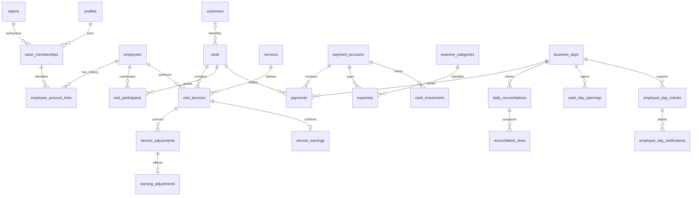

# Дерекқор схемасының ұсынысы

Бұл — P1 шолуынан кейін нақтыланған логикалық схема, SQL миграциясы емес. Бекітілген техникалық шешімдер [README](README.md) ішінде; комиссия формуласы, күн жабу жауаптылары және басқа операциялық рәсімдер [06-business-assumptions.md](06-business-assumptions.md) ішінде әлі расталмаған деп белгіленген.

## 1. Жалпы келісімдер

- Негізгі кілттер `uuid`; уақыт `timestamptz`, DB-де абсолют уақыт сақталады. Көрсету және жұмыс күні үшін `Asia/Almaty` IANA аймағы қолданылады; сервердің жергілікті уақытына сенбейміз.
- Ақша `bigint` minor units түрінде: `15000 KZT = 1500000` тиын. Floating-point қолданылмайды. API үлкен integer-ді decimal string ретінде тасымалдайды; UI-де қауіпсіз түрлендіру болады. Бүтін теңгемен енгізу ережесі бизнес тарапынан расталады.
- Комиссия `rate_bps`: `4000 = 40%`. Әр қызмет жолына half-up — ұсынылған тәсіл; дөңгелектеу тәсілі мен дәлдігі A12 арқылы расталады.
- Әр salon-bound кестеде `salon_id`, `id`, `created_at` болады. Өзгеретін анықтамалықта `updated_at`, `updated_by`; жазылатын домендік оқиғада `created_by`, `command_id` болады. Actor өрістері `profiles.id`-ге, `command_id` — `command_requests.id`-ге сілтейді. Command/audit кестелері төмендегі өз metadata өрістерін қолданады; command өзіне сілтеме жасамайды. Actor-ды клиент емес, тексерілген DB сессиясы анықтайды.
- Әр кестеде `PRIMARY KEY (id)` және scoped байланыстар үшін `UNIQUE (salon_id, id)`. Барлық tenant байланыстары composite FK `(salon_id, parent_id)` арқылы сол салонға тіреледі.
- `effective_at timestamptz` — қызмет орындалған не ақша шын қозғалған уақыт; `effective_business_date date` сол уақыттан салонның бекітілген timezone/cutoff ережесімен алынады. `created_at` — DB жазған тіркеу уақыты; `recorded_business_date` — тіркеу күні. `correction_commands.corrected_at` — түзету командасының уақыты. Bookkeeping reversal/replacement жаңа ақша қозғалысы емес: олардың effective кезеңі түзетілетін фактіні сипаттайды. Қалыпты операция, late entry және correction осы мағыналарды өзгертпейді.
- `effective_business_date` және `recorded_business_date` үшін FK `(salon_id, date)` → `business_days(salon_id, business_date)`; тіркеу күні ашық болуы керек. `closed/unreconciled` effective күнге тек Owner approval-мен жаңа historical correction/late entry қосылады; бұрынғы жол мен бар closure snapshot өзгермейді. Күн ережесі қолданылғаннан кейін оның тарихи мәнін өзгертпейміз.
- Қаржылық жазбаларға hard delete және кәдімгі UPDATE жоқ. Анықтамалықтар `is_active` арқылы архивтеледі. Маңызды FK үшін `ON DELETE RESTRICT`; Auth аккаунтын жою қаржы тарихын cascade жоймайды.
- Бизнес фактілері JSON ішіне жиналмайды. JSONB тек аудиттегі сүзілген өзгеріс, idempotency нәтижесінің ID-лері және түзету ұсынысының нұсқаланған payload-ы үшін.

## 2. Негізгі байланыстар



ER диаграммасы негізгі байланыстарды ғана көрсетеді. Толық кесте тізімі төменде. `payments` қызмет жолына тәуелді емес; бір келудің әр қызметіне төлем бөлу MVP-де қажет емес.

## 3. Аккаунттар және анықтамалықтар

Төмендегі өрістер жалпы `id`, `salon_id`, timestamps және actor өрістеріне қосылады. `?` nullable өрісті білдіреді. `profiles` — global кесте; `salons.id` — tenant идентификаторы.

| Кесте | Негізгі өрістер | Байланыстар және шектеулер |
| --- | --- | --- |
| `salons` | `name text`, `timezone text`, `currency char(3)`, `day_cutoff time`, `last_command_sequence bigint` | MVP: бір салон, KZT; timezone IANA allowlist; cutoff мәні әлі расталады; sequence DB-де ғана өседі |
| `profiles` | `auth_user_id uuid?`, `display_name text`, `locale text`, `disabled_at timestamptz?` | `auth_user_id` unique FK → `auth.users`; бөлек immutable profile ID аудит actor-ын сақтайды; locale `kk/ru` |
| `salon_memberships` | `profile_id uuid`, `role text`, `is_active boolean` | FK → profiles; unique `(salon_id, profile_id)`; role `owner/administrator/employee`; соңғы белсенді Owner-ды алып тастауға болмайды |
| `employees` | `display_name text`, `is_active boolean`, `started_on date?`, `ended_on date?` | Аккаунты жоқ орындаушы болуы мүмкін; күндер реті тексеріледі. Mutable `membership_id` бұл кестеде болмайды |
| `employee_account_links` | `employee_id uuid`, `membership_id uuid`, `valid_from timestamptz`, `valid_to timestamptz?`, `linked_by uuid`, `ended_by uuid?`, `reason text` | FK employee/membership/profile; белсенді employee және membership үшін бөлек partial unique; тек Owner link/reassign командасы. Ескі байланысты жабу және жаңасын ашу атомарлы, бұрынғы creator/actor өзгермейді |
| `service_categories` | `code text`, `name_kk text`, `name_ru text`, `is_active boolean` | unique `(salon_id, code)` |
| `services` | `category_id uuid`, `code text`, `default_price_minor bigint`, `duration_minutes integer?`, `is_active boolean` | FK category; баға ≥ 0; duration > 0; unique salon/code |
| `service_translations` | `service_id uuid`, `locale text`, `name text` | FK service; unique salon/service/locale; екі тілдегі атау каталогты жариялау кезінде тексеріледі |
| `employee_service_rates` | `employee_id uuid`, `service_id uuid?`, `valid_from timestamptz`, `valid_to timestamptz?`, `rule_type text`, `rate_bps integer?`, `fixed_amount_minor bigint?` | FK employee/service; `percentage/fixed/none`; бір rule type-қа тек тиісті өріс; 0–10000 bps; интервалдар қабаттаспайды; нақты service ережесі employee default-ынан басым |
| `payment_methods` | `code text`, `name_kk text`, `name_ru text`, `is_active boolean` | cash/card/qr/bank_transfer; unique salon/code |
| `payment_accounts` | `method_id uuid`, `name text`, `is_cash boolean`, `is_active boolean` | FK method; салыстыру арналары; қолданылғаннан кейін method/is_cash өзгермейді, жаңа арнаға жаңа account ашылады. Банк шотының толық деректемелері қажет емес |
| `expense_categories` | `code text`, `name_kk text`, `name_ru text`, `is_active boolean` | unique salon/code; MVP операциялық шығындар |

Каталогтағы баға ағымдағы ұсынысты білдіреді. Ескі операция сол кездегі баға snapshot-ын сақтайды. Комиссия ережелері бұрынғы snapshot-тарды қайта есептемейді. Бұл тарихи фактіні сақтау үшін әдейі жасалған шектеулі денормализация.

## 4. Клиенттер, келулер және қызметтер

| Кесте | Негізгі өрістер | Байланыстар және шектеулер |
| --- | --- | --- |
| `customers` | `display_name text?`, `phone_e164 text?`, `preferred_locale text?`, `archived_at timestamptz?` | Клиент карточкасында кемінде ат не телефон; аноним келуге бос карточка жасалмайды. Телефон indexed, бірақ family-shared нөмірлер үшін автоматты unique/merge жоқ |
| `customer_consents` | `customer_id uuid`, `purpose text`, `policy_version text`, `event_type text`, `recorded_at timestamptz`, `capture_method text` | FK customer; append-only grant/withdraw оқиғалары; нақты consent мәтіні мен заңды негіз іске қосуға дейін бекітіледі; маркетинг бөлек мақсат |
| `visits` | `visit_number text`, `customer_id uuid?`, `opened_at timestamptz`, `completed_at timestamptz?`, `status text`, `version integer`, `debt_reason text?` | FK customer; unique salon/visit_number; нөмір құпия token емес; `open/completed/cancelled`; empty open visit мүмкін, completed үшін қызмет керек; версия conflict үшін |
| `visit_participants` | `visit_id uuid`, `employee_id uuid`, `granted_by uuid`, `granted_at timestamptz`, `revoked_at timestamptz?`, `revoked_by uuid?`, `reason text?` | FK visit/employee/profile; бір active visit/employee жұбы; revoke бұрынғы қызметтерді жоймайды; Employee өз ашқан келуіне автоматты қатысушы, басқа маманды Owner/Administrator қосады (операциялық ұсыныс) |
| `visit_services` | `visit_id uuid`, `service_id uuid`, `employee_id uuid`, `effective_at timestamptz`, `effective_business_date date`, `recorded_business_date date`, `quantity integer`, `unit_price_minor bigint`, `discount_minor bigint`, `discount_reason text?`, `service_name_kk_snapshot text`, `service_name_ru_snapshot text` | FK visit/service/employee/days; quantity > 0; price ≥ 0; discount 0..gross; line total = quantity × unit price − discount. Қызметті комиссиясыз сақтауға болады; Employee тек өз performer ID-імен және active participant құқығымен жазады |
| `service_adjustments` | `visit_service_id uuid`, `correction_id uuid`, `kind text`, `amount_delta_minor bigint`, `effective_at timestamptz`, `effective_business_date date`, `recorded_business_date date`, `reason text` | FK original service/correction/days; `price_correction/discount/refund_allowance/void/commission_correction`; append-only; void қалған сомаға қарсы; commission-only delta = 0; original service және correction бір салонда |
| `service_earnings` | `visit_service_id uuid`, `rate_rule_id uuid`, `rule_type_snapshot text`, `rate_bps_snapshot integer?`, `fixed_amount_minor_snapshot bigint?`, `basis_minor bigint`, `earned_minor bigint`, `confirmed_by uuid?`, `confirmed_at timestamptz`, `confirmation_mode text` | FK service/rate/profile; unique service; immutable baseline. `automatic` — бұрын Owner бекіткен rule-мен DB есептейді; `owner_review` — pending-ті Owner растайды, confirmed_by міндетті. Rate сол employee/service/effective_at-қа сәйкес; сомалар құпия |
| `earning_adjustments` | `service_adjustment_id uuid`, `service_earning_id uuid`, `amount_delta_minor bigint`, `reason text` | FK adjustment/earning; adjustment сол service-ке тиесілі; unique service_adjustment_id; final earning ≥ 0; бір транзакцияда жасалады |

Комиссия базасының операциялық ұсынысы — жеңілдіктен кейінгі орындалған қызмет сомасы; бұл салонның расталған формуласы емес (A04). Ақша түсуіне қарай есептеу талап етілсе, payment allocation және earning recognition бөлігі іске асыруға дейін қайта қаралады. Қандай формула таңдалса да, қызметті тіркеу оған тәуелді болмайды.

Ұсынылған формула үшін percentage earning = round(basis_minor × rate_bps / 10000), fixed earning = fixed_amount_minor × quantity. Rate таңдау: `valid_from <= service.effective_at < valid_to`, open-ended valid_to рұқсат; нақты service override default-тан басым. Түпкі дөңгелектеу саясаты A12 арқылы расталады.

### Pending комиссияның нақты мағынасы

Қызметті сақтағанда жарамды расталған rule болмаса, `service_earnings` жолы жасалмайды, бірақ `visit_services`, audit және `pending_commission` data-quality issue бір транзакцияда сақталады. Оқу projection-ы `commission_status = pending`, `earned_minor = null` қайтарады. Бұл 0% немесе 0 ₸ емес. Расталған earning болса `commission_status = confirmed`; нөл тек Owner бекіткен explicit `none` не заңды нөлдік есеп нәтижесі болуы мүмкін.

`confirm_commission` Owner командасы қолайлы effective ережемен immutable baseline жасайды, осы қызметтің бұрынғы adjustments әсерін earning_adjustments арқылы қосады және issue-ді атомарлы жабады. Қайта шақыру екінші earning жасамайды. Rule-дың өзгеруі бұрын расталған earnings-ті өзгертпейді. Қызмет void болса pending issue `service_voided` себебімен жабылады, қызмет ағымдағы комиссия жиынтығына кірмейді; жалған нөлдік earning жасалмайды. Void расталған earning-тің қалған сомасын кері шығарады.

Dashboard/export тек расталған табысты және `pending_commission_count` санын бірге көрсетеді; pending бар жиынтық «толық расталған табыс» деп аталмайды. Pending комиссия service completion, payment recording немесе кассадағы нақты ақшаны санауға кедергі емес.

Қате орындаушы/қызмет таңдалса, ескі жол void жасалып, дұрыс жаңа жол және confirmed не pending комиссия нәтижесі жазылады. Бастапқы performer overwrite болмайды. Жаңа жол мен void жаңа `correction_commands.command_id` арқылы байланысады; бастапқы жол бастапқы command-ын сақтайды. Клиентті қате байланыстыру жеке рұқсатпен, аудитпен түзетіледі.

Қызметтің effective сомасы — baseline + барлық adjustment. `void` болған қызметке жаңа price adjustment қабылданбайды; қажет болса дұрыс жаңа жол енгізіледі. Комиссия азаюы refund-қа автоматты байланбайды: келісілген ереже және тиісті service adjustment қажет.

## 5. Ақша операциялары

Барлық money magnitude оң, kind таңбаны анықтайды. Payments/expenses/cash_movements ортақ өрістері: `effective_at`, `effective_business_date`, `recorded_business_date`, `created_at`, `created_by`, `command_id`, `correction_id uuid?`, `entry_origin text` (`live/late_entry`), `source_reference text?`, `late_entry_reason text?`, `authorized_by uuid?`. FK correction/profile/days міндетті мағынасына сай тексеріледі. Late entry-ге reason және тексерілген authorization керек; source_reference idempotency key-дің орнына жүрмейді. Visit services үшін де entry_origin/source_reference/late_entry_reason/authorized_by қолданылады.

| Кесте | Негізгі өрістер | Ереже |
| --- | --- | --- |
| `payments` | `visit_id uuid`, `payment_account_id uuid`, `kind text`, `amount_minor bigint`, `original_payment_id uuid?`, `external_reference text?`, `reason text?` | `receipt/refund/reversal`; FK visit/account/day/original; amount > 0; currency салоннан; refund тек receipt-ке, reversal тек receipt/refund-қа сілтейді |
| `expenses` | `category_id uuid`, `payment_account_id uuid`, `kind text`, `amount_minor bigint`, `description text`, `original_expense_id uuid?` | `expense/reversal`; нақты төленген expense және оның қате жазбасын кері шығару; FK category/account/day/original; amount > 0 |
| `cash_movements` | `payment_account_id uuid`, `kind text`, `amount_minor bigint`, `reason text`, `original_movement_id uuid?` | `cash_in/cash_out/reversal`; кассаға float қосу, инкассация, Owner қаражатын алу; cash account қана; қызмет түсімі не операциялық expense ретінде саналмайды |

Payment sign: receipt `+amount`, refund `−amount`, reversal `−sign(original) × amount`. Reversal толық бастапқы сомаға және сол шотқа жасалады, reversal-of-reversal жоқ. Әр түпкі жолға ең көбі бір reversal: nullable reference үшін kind-filtered unique index қажет. Expense/cash reversal да осы ережеге бағынады.

Receipt-ке refund өз бастапқы receipt-імен бір visit ішінде болуға тиіс. Refund сомалары белсенді түпкі receipt қалдығынан аспайды. Refund бар receipt-ті reverse ету қабылданбайды: мұндай қателер Owner қарауына өтеді; шын болған қайтарымды жасыруға болмайды. Қате refund жазбасын reverse ету тек шын мәнінде ақша шықпаған bookkeeping қатесін түзетуге арналған.

`correct_payment` reversal мен replacement-ті бір жаңа correction command-ында жазады. Екеуінде `correction_id` бар; reversal.original_payment_id бастапқы жолға сілтейді. Бастапқы payment.command_id өзгермейді. Бір correction-дағы source және outputs сол visit-ке жатады. Replacement болмаған cancellation да explicit reason-мен сақталады. Нақты refund — correction reversal емес, өзінің ақша қозғалысы уақыты бар бөлек payment.

### Тарихи әсер және бүгінгі ақша

Тарихи bookkeeping reversal бастапқы жолдың effective уақытын алады; replacement дұрыс нақты оқиғаның effective уақытын алады. Уақыттың өзі қате болса, Owner дәлелмен дұрыс кезеңді көрсетеді. Кәдімгі historical correction-ды бүгінгі live receipt ретінде жасыруға болмайды. `created_at`, recorded күн және corrected_at әрқашан нақты жазу/түзету уақытын сақтайды.

Мысалдар — жасанды: кеше алынған 10 000 ₸ cash қате card болып жабылды. Бүгін card reversal + cash replacement кеше effective күнімен тіркеледі. Кеше snapshot өзгермейді, кеше restated totals өзгереді; бүгінгі кассаға +10 000 қосылмайды, өйткені бүгінгі opening кеше саналған actual-дан алынған. Кеше алынған, бүгін кеш енгізілген cash receipt те бүгінгі inflow емес. Ал бүгін шын қайтарылған 3 000 ₸ refund бүгінгі effective күнге жатады және бүгінгі cash-ты азайтады.

Тарихи correction-ның дұрыс effective күні бүгін болып шықса, бүгінгі әсер тек сол күні шынымен болған оқиғадан туындайды; correction timestamp-ынан туындамайды. Осындай ерекше жағдайлар Owner рұқсатымен және дерек сапасы тексеруімен өңделеді.

Дұрыс receipt үшін paid balance қызметтің effective сомасынан аспайды. Refund, service adjustment немесе correction нәтижесінде debt/credit пайда болса, ол ашық көрсетіледі. Қайтарым төлемді де, қызмет түсімін де бір мезгілде автоматты төмендетпейді.

Expenses MVP-де бір төленген шығынға бір шот қолданады; supplier debt және split expense settlement кейінгі кеңейту. Қате expense толық reversal + replacement арқылы түзетіледі. Жеткізушіден нақты ақшаның қайтарылуы reversal емес; осы сценарий жиі болса, іске асыруға дейін expense refund моделі қосылады.

## 6. Күн, бақылау және тарих

| Кесте | Негізгі өрістер | Ереже |
| --- | --- | --- |
| `business_days` | `business_date date`, `status text`, `opened_by uuid?`, `opened_at timestamptz?`, `closed_by uuid?`, `closed_at timestamptz?` | unique salon/date; `open/closed/unreconciled`; бір салонда бір active open day. `open/closed` үшін opened metadata міндетті; `closed` үшін closed metadata міндетті. Outage салдарынан мүлде ашылмаған тарихи күнді Owner тек metadata ретінде unreconciled жасай алады: opened/closed metadata null, жасаған actor/time жалпы created өрістерінде; жалған opening/closure/actual құрылмайды |
| `cash_day_openings` | `business_date date`, `payment_account_id uuid`, `previous_line_id uuid?`, `opening_minor bigint`, `counted_opening_minor bigint`, `continuity_status text`, `confirmed_by uuid`, `confirmed_at timestamptz`, `reason text?` | FK day/account/previous reconciliation line/profile; unique salon/day/account. `continuous` үшін previous line сол account-тың алдыңғы жабылған жұмыс күні және opening=previous actual; initial/gap кезінде nullable previous FK, нақты санау, reason және Owner approval міндетті |
| `daily_reconciliations` | `business_date date`, `prepared_by uuid`, `approved_by uuid`, `closed_at timestamptz`, `cutoff_sequence bigint`, `calculation_version text`, `note text?` | FK day/profile; unique salon/date; immutable closure snapshot; cutoff салонның transaction-ordered command sequence мәнін бекітеді |
| `reconciliation_lines` | `reconciliation_id uuid`, `payment_account_id uuid`, `cash_opening_id uuid?`, `opening_minor bigint`, `expected_minor bigint`, `actual_minor bigint`, `difference_reason text?`, `evidence_reference text?` | FK reconciliation/account/opening; unique reconciliation/account; cash үшін opening FK міндетті және day/account сәйкестігі тексеріледі; electronic үшін opening=0 және FK=null |
| `correction_requests` | `requested_by uuid`, `target_type text`, `target_id uuid`, `reason text`, `proposed_change jsonb`, `status text`, `reviewed_by uuid?`, `reviewed_at timestamptz?`, `applied_command_id uuid?` | Type allowlist; target сол салонда бар екенін trusted function тексереді; JSON financial truth емес; approval мен түзету атомарлы |
| `correction_commands` | `command_id uuid`, `request_id uuid?`, `reason text`, `approved_by uuid`, `corrected_at timestamptz` | FK command/request/profile; unique command; immutable орындалған correction metadata; historical correction-ға Owner approval; command нәтижелері бастапқы фактілерге нақты FK арқылы сілтейді |
| `command_requests` | `actor_id uuid`, `operation text`, `idempotency_key uuid`, `request_hash text`, `sequence bigint`, `result_refs jsonb`, `completed_at timestamptz` | unique salon/actor/operation/key және salon/sequence; барлық домендік жазбалармен бір транзакция; result тек ID/қауіпсіз summary; hash canonical request-тен |
| `audit_events` | `actor_id uuid?`, `actor_type text`, `action text`, `entity_type text`, `entity_id uuid?`, `command_id uuid?`, `before_data jsonb?`, `after_data jsonb?`, `reason text?`, `occurred_at timestamptz` | Append-only; DB trigger/trusted function; actor_type user/system; құпия және қажетсіз PII көшірілмейді |
| `employee_day_checks` | `business_date date`, `employee_id uuid`, `data_version bigint`, `expected_by uuid`, `expectation_source text` | FK day/employee/profile; unique salon/day/employee; міндетті тексерілетін cohort. Қызмет жазу employee/day жолын автоматты жасайды; қызметі нөл болатын жұмыс істеген мамандарды жауапты адам қосады (A30) |
| `employee_day_verifications` | `check_id uuid`, `version bigint`, `confirmed_by uuid`, `confirmed_at timestamptz`, `service_count integer`, `note text?` | FK check/profile; unique check/version; immutable жеке растау. Растайтын аккаунт сол employee-ге белсенді байланысқан болуы керек; әкімші оның орнына қол қоймайды |
| `data_quality_issues` | `issue_key text`, `issue_type text`, `target_type text`, `target_id uuid`, `related_entity_id uuid?`, `status text`, `assigned_to uuid?`, `resolution_reason text?`, `resolved_by uuid?`, `resolved_at timestamptz?` | unique salon/issue_key; typed target allowlist + scope validation; `open/resolved/dismissed`; түзетулер аудитпен. Issue пайдаланушыға рұқсат етілмеген бастапқы деректерді жарияламайды |

Audit және correction target-тері polymorphic metadata болғандықтан кәдімгі FK жоқ; allowlist, салонға тиесілікті тексеру және type-specific функция міндетті. Қаржылық негізгі байланыстардың бәрі нақты FK арқылы сақталады.

Data-quality target-тері де осы ережеге бағынады. `pending_commission` тек commission confirmation немесе service void арқылы жабылады; оны жай dismiss етуге болмайды. `unresolved_payment`, `incomplete_visit`, `duplicate_candidate`, `verification_required`, `reconciliation_difference`, `historical_change` түрлері анықталады. Duplicate candidate — күдік, автоматты delete/merge емес. Детерминдік тексеру командалары мен күн жабу issue-лерді issue_key бойынша upsert жасайды; қайта тексеру дубль issue қоспайды. Live read projection есептелетін күйді көрсетеді, SELECT жанама түрде жазу жасамайды.

Service/adjustment/performer/effective күн өзгерісінің affected employee/day `data_version` мәні сол транзакцияда өседі. Бұрынғы verification өшірілмейді, бірақ соңғы verification.version ≠ data_version болса `verification_required` болады. Closed-day тарихи түзету де осы ережеге бағынады; қайта тексеру closure-ды қайта ашпайды. Жұмыс істеген, бірақ қызмет енгізбеген мамандар cohort-қа қосылмаса, жүйе олардың өткізіп алған қызметін біле алмайды; нақты roster рәсімі A30 арқылы расталады.

Қолма-қол күн жабу формуласы:

```text
expected_cash = opening_cash
              + signed_payments_for_effective_day
              - net_expenses_for_effective_day
              + signed_cash_movements_for_effective_day
difference = actual_cash - expected_cash
```

Жиынтық тек сол account және `effective_business_date` жолдарынан алынады; жабу кезінде command.sequence ≤ cutoff_sequence. `recorded_business_date` бүгін болғаны кеше effective фактісін бүгінгі айналымға қоспайды. Continuous күнде opening бұрынғы бекітілген actual_cash-қа тең; counted_opening айырмашылығы болса issue ашылады, opening-ті үндемей өзгертіп айырманы жасыруға болмайды. Historical correction opening-ті автоматты қайта есептемейді. Initial/gap — нақты санауға сүйенген ерекше baseline, Owner approval/reason және continuity issue-мен белгіленеді; бұл өткен кезең толық салыстырылды дегенді білдірмейді. Қалыпты opening-ді нақты кім санайтыны A16 арқылы расталады. Day-close барлық белсенді немесе сол күні қолданылған account-ты қамтиды. Ақша жоқ кезде де 0 нақты саналғанын енгізу қажет; бос мән 0 деп саналмайды.

`unreconciled` тарихи күн ашық recorded күн ретінде қолданылмайды; оған late entry тек Owner approval-мен жасалады. Жоғалған actual санауды кейін ойдан жасауға болмайды. Келесі күнге өтуге қажет gap baseline және unresolved мәселе көрінеді. Жинау басталғанға дейінгі ескі Excel тарихы осы exception-мен жаппай импортталмайды: staging/verification кейінгі бөлек scope.

Айырмашылық, pending commission және орындалмаған employee verification — үш бөлек белгі. Қаржы snapshot-ын жабу олардың бәрін автоматты resolved қылмайды. Қай мәселе жабуды тоқтататыны немесе exception-мен қабылданатыны A14/A30 арқылы бекітіледі; бизнес рәсімі бекітілмей production жабу саясаты енгізілмейді. Техникалық минимум: мәселе жасырылмайды, exception болса authorized approver/reason аудитте сақталады.

Electronic account үшін `opening_minor = 0`, expected — сол effective күннің gross receipt/refund/reversal айналымы. Actual — терминал/QR-дың сол негіздегі есебі. Банкке комиссия шегеріліп кейін түскен net settlement-пен тікелей салыстырылмайды. Комиссия белгілі болғанда бөлек expense ретінде тіркеледі. Әдіс/шотты архивтеу оның сол күнгі жолын жоймайды. Ескі closure snapshot, бүгін жазылған correction және restated report қатар қолжетімді; original discrepancy тек түсіндірме/шешім оқиғасымен байланыстырылады, өшірілмейді.

## 7. Өзгермейтін ережелерді қайда тексереміз?

| Ереже | Орындау орны |
| --- | --- |
| Міндетті өріс, enum, оң сома, discount диапазоны | UI + server validation + DB NOT NULL/CHECK |
| Бір салонға тиесілік, reference бар болуы | Composite FK + RLS/command scope |
| Қайталанған кілт, жалғыз reversal, жалғыз closure | Unique/partial unique indexes |
| Комиссия интервалдарының қабаттаспауы | Exclusion constraint немесе transaction lock-пен тексерілетін trusted команда |
| Refund лимиті, төлем қалдығы, final service/earning ≥ 0 | DB transaction, original payment/visit row lock; жай CHECK жеткіліксіз |
| Жабық effective күнге append, түзету рұқсаты, соңғы Owner | Арнайы DB командалары, тексерілген approval және locks; кәдімгі live write қабылданбайды |
| Ортақ келуге қатысу, өз performer-і, аккаунт reassignment | DB командасы + RLS; account link/reassign тек Owner |
| Verification ескіруі, pending commission күйі | Сол command транзакциясы және deterministic projections; null ешқашан үнсіз 0 емес |
| Аудит пен негізгі жазбаның бірге сақталуы | DB trigger/бір транзакция; audit қатесі негізгі жазуды да тоқтатады |

## 8. Ұсынылатын команда шекаралары

`record_visit`, `grant_visit_participant`, `revoke_visit_participant`, `append_visit_service`, `complete_visit`, `record_payment`, `record_late_entry`, `refund_payment`, `correct_payment`, `adjust_service`, `confirm_commission`, `record_expense`, `correct_expense`, `record_cash_movement`, `open_business_day`, `close_business_day`, `confirm_employee_day`, `run_data_quality_checks`, `resolve_quality_issue`, `link_employee_account`, `reassign_employee_account`, `change_membership_role`.

Әр команда: identity/белсенді profile/membership → salon scope → салонның write lock-ы → idempotency lookup → affected business days → visits → payment/service/employee-check жолдары → lock астында бизнес/рұқсатты қайта тексеру → sequence бөлу → өзгерістер/verification invalidation/issues → audit → нәтиже. Бірнеше ID сұрыпталған ретпен алынады. MVP-дегі бір салонға command жазуын осы lock-пен тізбектеу snapshot cutoff-ын commit ретімен сәйкестендіреді; sequence тек atomic command құрамында өседі. Кейінгі масштабтау осы кепілдікті сақтауы тиіс. Бұрын біткен idempotent request нәтижесін тексеру close-day/role өзгерісі болған жағдайда да ағымдағы оқу рұқсатынан аспайды. Deadlock қатесіне шектеулі retry сол key-мен ғана.

Клиенттен келген total, commission, actor, approval не role сенімді дерек емес. Қорытынды DB-де қайта есептеледі. Completed visit-ке service append late-entry/correction ретінде себеппен және тиісті рұқсатпен жасалады. Қалыпты қызмет open visit-ке жазылады. Employee өз орындалған қызметін комиссияға тәуелсіз сақтайды; орындалмаған/күмәнді мәліметті жалған расталған фактіге айналдырмай, incomplete visit/issue арқылы белгілейді.

## 9. Индекстер және есептер

Бастапқы индекстер: membership `(profile_id, salon_id, is_active)`; active employee_account_links; visits salon/visit_number және customer/opened_at; active visit_participants visit/employee; services category/active; visit_services visit және employee/effective_at; payments visit және `(salon_id, effective_business_date, payment_account_id)`; expenses/day/account; adjustments original ID; commands salon/sequence; checks day/employee; issues salon/status/type; audit salon/date/entity; customer normalized phone.

RLS predicate және FK join өрістеріне индекстер қосылады. Индекс санын нақты query plan бойынша тексереміз. Totals жеке mutable бағандарға көшірілмейді; есептелетін view/RPC қолданылады. Күн жабу snapshot-ы — есептің сол сәттегі дәлелін сақтау үшін exception.

Тарихи есепте «жабылған сәттегі ақша snapshot-ы» және «кейінгі түзетулер ескерілген есеп» бөлек. Қызмет/комиссияның as-of есебі immutable фактілердің command.sequence ≤ cutoff_sequence сүзгісімен құралады; кейін расталған комиссия бұрынғы pending күйді кері өзгертпейді. Клиенттің mutable профилінен бұрынғы телефонды қайта құру есептің талабы емес. Экспортта effective кезең, as_of_sequence, calculation_version және pending саны беріледі. Клиенттің жүйеде алғаш байқалған келуі өміріндегі алғашқы келу деп аталмайды; аноним келулер retention-нан бөлек қамту метрикасына кіреді.

## 10. Ескі Excel-ге қатынас

MVP жаңа деректерді келісілген басталу күнінен жинайды. Excel production кестелеріне тікелей импортталмайды. Кейін қажет болса жеке staging аймағы, source file hash, source row, import batch, validation errors және `unverified/verified/rejected` provenance қосылады. Owner растағаннан кейін ғана дедупликацияланған деректер бақыланатын импорт командасымен өтеді. Ескі және жаңа деректердің сапасы есепте ажыратылады.
