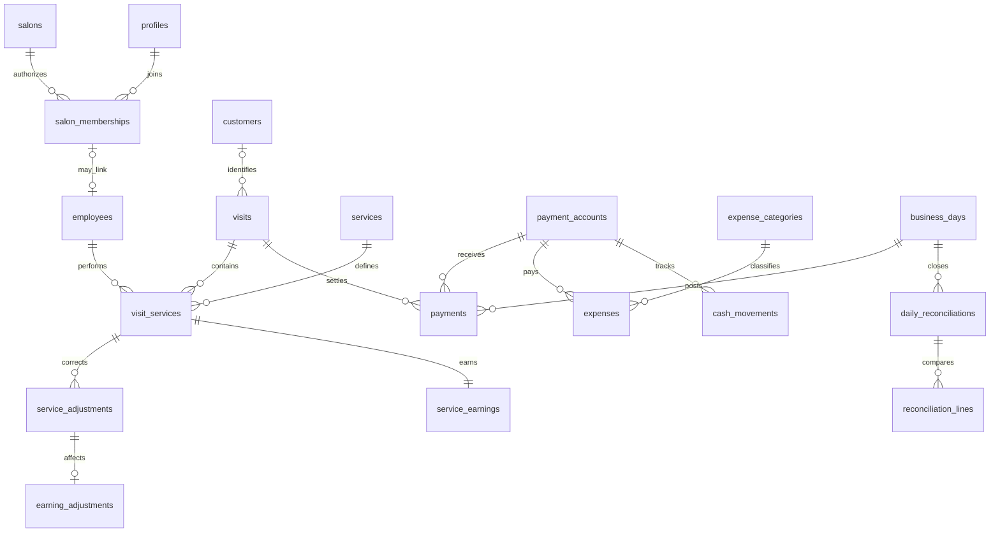

# Дерекқор схемасының ұсынысы

Бұл — логикалық схема. SQL миграциясы емес; бизнес ережелері қаралғаннан кейін физикалық схема мен RLS бірге жазылады.

## 1. Жалпы келісімдер

- Негізгі кілттер `uuid`; уақыт `timestamptz`, DB-де абсолют уақыт сақталады. Көрсету және жұмыс күні үшін `Asia/Almaty` IANA аймағы қолданылады; сервердің жергілікті уақытына сенбейміз.
- Ақша `bigint` minor units түрінде: `15000 KZT = 1500000` тиын. Floating-point қолданылмайды. API үлкен integer-ді decimal string ретінде тасымалдайды; UI-де қауіпсіз түрлендіру болады. Бүтін теңгемен енгізу ережесі бизнес тарапынан расталады.
- Комиссия `rate_bps`: `4000 = 40%`. Әр қызмет жолына half-up дөңгелектеу; дөңгелектеу дәлдігі тиын немесе теңге болатыны алдын ала бекітіледі.
- Әр salon-bound кестеде `salon_id`, `id`, `created_at` болады. Өзгеретін анықтамалықта `updated_at`, `updated_by`; жазылатын домендік оқиғада `created_by`, `command_id` болады. Actor өрістері `profiles.id`-ге, `command_id` — `command_requests.id`-ге сілтейді. Command/audit кестелері төмендегі өз metadata өрістерін қолданады; command өзіне сілтеме жасамайды. Actor-ды клиент емес, тексерілген DB сессиясы анықтайды.
- Әр кестеде `PRIMARY KEY (id)` және scoped байланыстар үшін `UNIQUE (salon_id, id)`. Барлық tenant байланыстары composite FK `(salon_id, parent_id)` арқылы сол салонға тіреледі.
- `business_date date` — тіркеу кезеңі; `occurred_at`/`performed_at` — оқиға уақыты; `created_at` — жүйеге жазылу уақыты. Үшеуі шатастырылмайды. Кеш тіркеуде себеп және рұқсат міндетті.
- Қаржылық жазбаларға hard delete және кәдімгі UPDATE жоқ. Анықтамалықтар `is_active` арқылы архивтеледі. Маңызды FK үшін `ON DELETE RESTRICT`; Auth аккаунтын жою қаржы тарихын cascade жоймайды.
- Бизнес фактілері JSON ішіне жиналмайды. JSONB тек аудиттегі сүзілген өзгеріс, idempotency нәтижесінің ID-лері және түзету ұсынысының нұсқаланған payload-ы үшін.

## 2. Негізгі байланыстар



ER диаграммасы негізгі байланыстарды ғана көрсетеді. Толық кесте тізімі төменде. `payments` қызмет жолына тәуелді емес; бір келудің әр қызметіне төлем бөлу MVP-де қажет емес.

## 3. Аккаунттар және анықтамалықтар

Төмендегі өрістер жалпы `id`, `salon_id`, timestamps және actor өрістеріне қосылады. `?` nullable өрісті білдіреді. `profiles` — global кесте; `salons.id` — tenant идентификаторы.

| Кесте | Негізгі өрістер | Байланыстар және шектеулер |
| --- | --- | --- |
| `salons` | `name text`, `timezone text`, `currency char(3)`, `day_cutoff time` | MVP: KZT; timezone IANA allowlist; күн шекарасы пилотқа дейін бекітіледі |
| `profiles` | `auth_user_id uuid?`, `display_name text`, `locale text`, `disabled_at timestamptz?` | `auth_user_id` unique FK → `auth.users`; бөлек immutable profile ID аудит actor-ын сақтайды; locale `kk/ru` |
| `salon_memberships` | `profile_id uuid`, `role text`, `is_active boolean` | FK → profiles; unique `(salon_id, profile_id)`; role `owner/administrator/employee`; соңғы белсенді Owner-ды алып тастауға болмайды |
| `employees` | `membership_id uuid?`, `display_name text`, `is_active boolean`, `started_on date?`, `ended_on date?` | Membership optional және салон ішінде unique; аккаунты жоқ орындаушы болуы мүмкін; күндер реті тексеріледі |
| `service_categories` | `code text`, `name_kk text`, `name_ru text`, `is_active boolean` | unique `(salon_id, code)` |
| `services` | `category_id uuid`, `code text`, `default_price_minor bigint`, `duration_minutes integer?`, `is_active boolean` | FK category; баға ≥ 0; duration > 0; unique salon/code |
| `service_translations` | `service_id uuid`, `locale text`, `name text` | FK service; unique salon/service/locale; екі тілдегі атау каталогты жариялау кезінде тексеріледі |
| `employee_service_rates` | `employee_id uuid`, `service_id uuid?`, `valid_from timestamptz`, `valid_to timestamptz?`, `rule_type text`, `rate_bps integer?`, `fixed_amount_minor bigint?` | FK employee/service; `percentage/fixed/none`; бір rule type-қа тек тиісті өріс; 0–10000 bps; интервалдар қабаттаспайды; нақты service ережесі employee default-ынан басым |
| `payment_methods` | `code text`, `name_kk text`, `name_ru text`, `is_active boolean` | cash/card/qr/bank_transfer; unique salon/code |
| `payment_accounts` | `method_id uuid`, `name text`, `is_cash boolean`, `is_active boolean` | FK method; «Негізгі касса», «Terminal 1», «Kaspi QR» сияқты салыстыру арналары; банк шотының толық деректемелері қажет емес |
| `expense_categories` | `code text`, `name_kk text`, `name_ru text`, `is_active boolean` | unique salon/code; MVP операциялық шығындар |

Каталогтағы баға ағымдағы ұсынысты білдіреді. Ескі операция сол кездегі баға snapshot-ын сақтайды. Комиссия ережелері бұрынғы snapshot-тарды қайта есептемейді. Бұл тарихи фактіні сақтау үшін әдейі жасалған шектеулі денормализация.

## 4. Клиенттер, келулер және қызметтер

| Кесте | Негізгі өрістер | Байланыстар және шектеулер |
| --- | --- | --- |
| `customers` | `display_name text?`, `phone_e164 text?`, `preferred_locale text?`, `archived_at timestamptz?` | Клиент карточкасында кемінде ат не телефон; аноним келуге бос карточка жасалмайды. Телефон indexed, бірақ family-shared нөмірлер үшін автоматты unique/merge жоқ |
| `customer_consents` | `customer_id uuid`, `purpose text`, `policy_version text`, `event_type text`, `recorded_at timestamptz`, `capture_method text` | FK customer; append-only grant/withdraw оқиғалары; нақты consent мәтіні мен заңды негіз іске қосуға дейін бекітіледі; маркетинг бөлек мақсат |
| `visits` | `customer_id uuid?`, `opened_at timestamptz`, `completed_at timestamptz?`, `status text`, `version integer`, `debt_reason text?` | FK customer; `open/completed/cancelled`; қызметі бар келуді cancellation арқылы жоғалтуға болмайды; версия optimistic conflict үшін |
| `visit_services` | `visit_id uuid`, `service_id uuid`, `employee_id uuid`, `performed_at timestamptz`, `business_date date`, `quantity integer`, `unit_price_minor bigint`, `discount_minor bigint`, `discount_reason text?`, `service_name_kk_snapshot text`, `service_name_ru_snapshot text` | FK visit/service/employee/day; quantity > 0; price ≥ 0; discount 0..gross; line total = quantity × unit price − discount; орындаушы міндетті |
| `service_adjustments` | `visit_service_id uuid`, `kind text`, `amount_delta_minor bigint`, `business_date date`, `reason text` | FK original service/day; `price_correction/discount/refund_allowance/void/commission_correction`; append-only; void нақты қалған сомаға қарсы, тек бір effective void; commission-only delta = 0 |
| `service_earnings` | `visit_service_id uuid`, `rate_rule_id uuid?`, `rule_type_snapshot text`, `rate_bps_snapshot integer?`, `fixed_amount_minor_snapshot bigint?`, `basis_minor bigint`, `earned_minor bigint` | FK service/rate; unique service; бір baseline earning; нөлдік ереже де explicit; қолжетімділігі қызмет жолынан бөлек |
| `earning_adjustments` | `service_adjustment_id uuid`, `service_earning_id uuid`, `amount_delta_minor bigint`, `reason text` | FK adjustment/earning; adjustment сол service-ке тиесілі; unique service_adjustment_id; final earning ≥ 0; бір транзакцияда жасалады |

Бастапқы болжам: комиссия жеңілдіктен кейінгі қызмет сомасынан, қызмет орындалған кезде есептеледі. Ол иесімен міндетті түрде расталады. Ақша түсуіне қарай есептеу талап етілсе, payment allocation және earning recognition моделі қайта қаралады.

Percentage earning = round(basis_minor × rate_bps / 10000); fixed earning = fixed_amount_minor × quantity. `none` ережесінде сома нөл. Ереже табылмағанда үнсіз 0% қолданылмайды: Owner каталогты дайындағанда explicit default бекітеді, ал ол жоқ болса сақтау түсінікті қатемен тоқтайды. Толық void қалған earning сомасын толық кері шығарады; partial adjustment бастапқы snapshot негізімен есептеліп, дөңгелектеу қалдығы ескеріледі.

Қате орындаушы/қызмет таңдалса, ескі жол void жасалып, дұрыс жаңа жол және earnings жазылады. Бастапқы performer overwrite болмайды. Жаңа жол мен void бір `command_id` арқылы байланысады. Клиентті қате байланыстыру жеке рұқсатпен, аудитпен түзетіледі.

Қызметтің effective сомасы — baseline + барлық adjustment. `void` болған қызметке жаңа price adjustment қабылданбайды; қажет болса дұрыс жаңа жол енгізіледі. Комиссия азаюы refund-қа автоматты байланбайды: келісілген ереже және тиісті service adjustment қажет.

## 5. Ақша операциялары

Барлық сомалар оң magnitude ретінде сақталады; kind таңбасын анықтайды. Payment/expense/cash movement жасалғанда `occurred_at`, `business_date`, actor, command және қажет кезде reason жазылады.

| Кесте | Негізгі өрістер | Ереже |
| --- | --- | --- |
| `payments` | `visit_id uuid`, `payment_account_id uuid`, `kind text`, `amount_minor bigint`, `original_payment_id uuid?`, `external_reference text?`, `reason text?` | `receipt/refund/reversal`; FK visit/account/day/original; amount > 0; currency салоннан; refund тек receipt-ке, reversal тек receipt/refund-қа сілтейді |
| `expenses` | `category_id uuid`, `payment_account_id uuid`, `kind text`, `amount_minor bigint`, `description text`, `original_expense_id uuid?` | `expense/reversal`; нақты төленген expense және оның қате жазбасын кері шығару; FK category/account/day/original; amount > 0 |
| `cash_movements` | `payment_account_id uuid`, `kind text`, `amount_minor bigint`, `reason text`, `original_movement_id uuid?` | `cash_in/cash_out/reversal`; кассаға float қосу, инкассация, Owner қаражатын алу; cash account қана; қызмет түсімі не операциялық expense ретінде саналмайды |

Payment sign: receipt `+amount`, refund `−amount`, reversal `−sign(original) × amount`. Reversal толық бастапқы сомаға және сол шотқа жасалады, reversal-of-reversal жоқ. Әр түпкі жолға ең көбі бір reversal: nullable reference үшін kind-filtered unique index қажет. Expense/cash reversal да осы ережеге бағынады.

Receipt-ке refund өз бастапқы receipt-імен бір visit ішінде болуға тиіс. Refund сомалары белсенді түпкі receipt қалдығынан аспайды. Refund бар receipt-ті reverse ету қабылданбайды: мұндай қателер Owner қарауына өтеді; шын болған қайтарымды жасыруға болмайды. Қате refund жазбасын reverse ету тек шын мәнінде ақша шықпаған bookkeeping қатесін түзетуге арналған.

Дұрыс receipt үшін paid balance қызметтің effective сомасынан аспайды. Refund, service adjustment немесе correction нәтижесінде debt/credit пайда болса, ол ашық көрсетіледі. Қайтарым төлемді де, қызмет түсімін де бір мезгілде автоматты төмендетпейді.

Expenses MVP-де бір төленген шығынға бір шот қолданады; supplier debt және split expense settlement кейінгі кеңейту. Қате expense толық reversal + replacement арқылы түзетіледі. Жеткізушіден нақты ақшаның қайтарылуы reversal емес; осы сценарий жиі болса, іске асыруға дейін expense refund моделі қосылады.

## 6. Күн, бақылау және тарих

| Кесте | Негізгі өрістер | Ереже |
| --- | --- | --- |
| `business_days` | `business_date date`, `status text`, `opened_by uuid`, `opened_at timestamptz`, `closed_by uuid?`, `closed_at timestamptz?` | unique salon/date; `open/closed`; барлық posting үшін composite FK salon/date; тек ашық күнге жазу |
| `daily_reconciliations` | `business_date date`, `prepared_by uuid`, `approved_by uuid`, `closed_at timestamptz`, `calculation_version text`, `note text?` | FK day; unique salon/date; соңғы бекітілген snapshot; форма draft-ы қаржылық факт емес |
| `reconciliation_lines` | `reconciliation_id uuid`, `payment_account_id uuid`, `opening_minor bigint`, `expected_minor bigint`, `actual_minor bigint`, `difference_reason text?`, `evidence_reference text?` | FK reconciliation/account; unique reconciliation/account; difference = actual − expected; cash және electronic негіздері бөлек |
| `correction_requests` | `requested_by uuid`, `target_type text`, `target_id uuid`, `reason text`, `proposed_change jsonb`, `status text`, `reviewed_by uuid?`, `reviewed_at timestamptz?`, `applied_command_id uuid?` | Type allowlist; target сол салонда бар екенін trusted function тексереді; JSON financial truth емес; approval мен түзету атомарлы |
| `command_requests` | `actor_id uuid`, `operation text`, `idempotency_key uuid`, `request_hash text`, `result_refs jsonb`, `completed_at timestamptz` | unique salon/actor/operation/key; домендік жазбалармен бір транзакция; result тек ID және қауіпсіз summary; hash canonical request-тен |
| `audit_events` | `actor_id uuid?`, `actor_type text`, `action text`, `entity_type text`, `entity_id uuid?`, `command_id uuid?`, `before_data jsonb?`, `after_data jsonb?`, `reason text?`, `occurred_at timestamptz` | Append-only; DB trigger/trusted function; actor_type user/system; құпия және қажетсіз PII көшірілмейді |

Audit және correction target-тері polymorphic metadata болғандықтан кәдімгі FK жоқ; allowlist, салонға тиесілікті тексеру және type-specific функция міндетті. Қаржылық негізгі байланыстардың бәрі нақты FK арқылы сақталады.

Қолма-қол күн жабу формуласы:

```text
expected_cash = opening_cash
              + net_cash_receipts
              - net_cash_expenses
              + net_cash_in
              - net_cash_out
difference = actual_cash - expected_cash
```

Келесі күннің `opening_cash` мәні бұрынғы бекітілген `actual_cash` сомасына сүйенеді. Алғашқы күндегі opening-ді Owner растайды. Айырмашылық келесі күні өздігінен «жабылды» деп есептелмейді; алдыңғы күнде сақталады. Day-close командасы барлық белсенді немесе сол күні қолданылған cash account үшін opening/closing continuity тексереді.

Electronic account үшін `opening_minor = 0`, expected — сол күннің gross receipt/refund/reversal айналымы. Actual — терминал/QR-дың сол негіздегі есебі. Банкке комиссия шегеріліп кейін түскен net settlement-пен тікелей салыстырылмайды. Комиссия белгілі болғанда бөлек expense ретінде тіркеледі. Әдіс/шотты жабу оның сол күнгі жолын жоймайды.

## 7. Өзгермейтін ережелерді қайда тексереміз?

| Ереже | Орындау орны |
| --- | --- |
| Міндетті өріс, enum, оң сома, discount диапазоны | UI + server validation + DB NOT NULL/CHECK |
| Бір салонға тиесілік, reference бар болуы | Composite FK + RLS/command scope |
| Қайталанған кілт, жалғыз reversal, жалғыз closure | Unique/partial unique indexes |
| Комиссия интервалдарының қабаттаспауы | Exclusion constraint немесе transaction lock-пен тексерілетін trusted команда |
| Refund лимиті, төлем қалдығы, final service/earning ≥ 0 | DB transaction, original payment/visit row lock; жай CHECK жеткіліксіз |
| Жабық күн, түзету рұқсаты, соңғы Owner | DB командалары және scoped locks |
| Аудит пен негізгі жазбаның бірге сақталуы | DB trigger/бір транзакция; audit қатесі негізгі жазуды да тоқтатады |

## 8. Ұсынылатын команда шекаралары

`record_visit`, `append_visit_service`, `complete_visit`, `record_payment`, `refund_payment`, `correct_payment`, `adjust_service`, `record_expense`, `correct_expense`, `record_cash_movement`, `close_business_day`, `change_membership_role`.

Әр команда: auth → белсенді membership → salon scope → idempotency → бизнес тексерулер → тұрақты ретпен lock → өзгерістер → аудит → нәтиже. Бірдей lock тәртібі: business day, visit, түпкі payment/service. Бірнеше ID болса, сұрыпталған рет қолданылады. Deadlock/serialization қатесіне шектеулі retry тек сол idempotency key-мен.

Клиенттен келген total, commission, actor немесе role сенімді дерек емес. Қорытынды DB-де қайта есептеледі. Completed visit-ке service append тек түзету құқығымен және себеппен. Қалыпты service жазу жұмыс барысындағы open visit-ке ғана.

## 9. Индекстер және есептер

Бастапқы индекстер: membership `(profile_id, salon_id, is_active)`; employees membership; visits `(salon_id, opened_at)` және customer/date; services category/active; visit_services visit және employee/performed_at; payments visit және `(salon_id, business_date, payment_account_id)`; expenses/day/account; adjustments original ID; audit salon/date/entity; customer normalized phone.

RLS predicate және FK join өрістеріне индекстер қосылады. Индекс санын нақты query plan бойынша тексереміз. Totals жеке mutable бағандарға көшірілмейді; есептелетін view/RPC қолданылады. Күн жабу snapshot-ы — есептің сол сәттегі дәлелін сақтау үшін exception.

Тарихи есепте екі көрініс болады: «жабылған сәттегі есеп» және «кейінгі түзетулер ескерілген есеп». Adjustment бастапқы қызметке байланысады, бірақ posting date өзгермейді. Есептің қай нұсқасы экспортталғаны жазылады.

## 10. Ескі Excel-ге қатынас

MVP жаңа деректерді келісілген басталу күнінен жинайды. Excel production кестелеріне тікелей импортталмайды. Кейін қажет болса жеке staging аймағы, source file hash, source row, import batch, validation errors және `unverified/verified/rejected` provenance қосылады. Owner растағаннан кейін ғана дедупликацияланған деректер бақыланатын импорт командасымен өтеді. Ескі және жаңа деректердің сапасы есепте ажыратылады.
